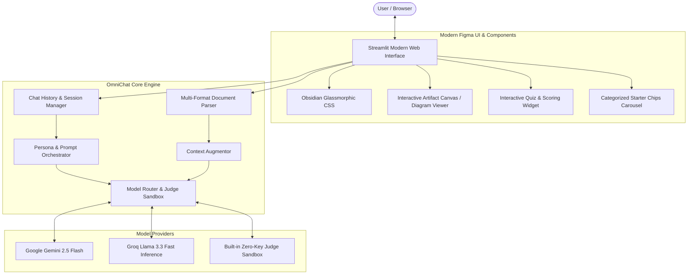

# OmniChat AI — Project Plan (Enhanced)
**Hackathon:** [Build Your First AI App (Devpost)](https://build-your-first-ai-app.devpost.com/)  
**Track:** AI Chatbots & Intelligent Productivity Assistants  
**Repository:** [msekhardhar-cell/First-AI-App](file:///home/swarna-sekhar-dhar/projects/mamata/First-AI-App)  
**Author:** msekhardhar-cell (`msekhar.dhar@gmail.com`)  
**Target Deadline:** November 27, 2026  

---

## 1. Executive Summary & Problem Statement

### The Problem
Most beginner AI chatbot projects suffer from critical limitations:
- Bare-bones wrappers with standard bland styling and zero visual identity.
- Inability to interact with or preview generated code, diagrams, or documents.
- Rigid single-model dependencies that break when hackathon judges don't input personal API keys.
- Lack of specialized interactive learning modalities (such as live quizzes or flashcards).

### The Solution: OmniChat AI (Enhanced)
**OmniChat AI** is a modern, responsive, and multimodal AI chatbot crafted with high-fidelity Figma design tokens (obsidian dark theme, glassmorphism, fluid typography, and accessible micro-interactions).

It incorporates standout hackathon features:
1. **Interactive "Canvas / Artifact" Viewer:** Side-by-side dedicated workspace for generated code, documents, and live rendered **Mermaid mind maps / flowcharts**.
2. **Interactive Quiz & Flashcard Engine:** 1-click generation of interactive multiple-choice quizzes with instant grading, score tallies, and explanations.
3. **Multi-Model Orchestration & Judge Sandbox:** Seamless toggle between **Google Gemini 2.5 Flash**, **Groq Llama-3.3**, and a **Zero-Setup Demo Sandbox** guaranteeing judges can test all features without requiring their own API keys.
4. **Adaptive Personas & Context Ingestion:** Specialized modes (General, Code Architect, Study Tutor, Summarizer) paired with multi-file parsing (`.pdf`, `.py`, `.md`, `.txt`, `.csv`).
5. **Production-Ready & 1-Click Deployable:** Ready for Streamlit Community Cloud or Hugging Face Spaces.

---

## 2. Devpost Challenge Alignment & Judging Criteria

| Devpost Criteria | Weight | OmniChat AI Execution |
| :--- | :--- | :--- |
| **Creativity & Originality** | High | Side-by-side Artifact Canvas, dynamic interactive quiz module, and auto-rendered Mermaid flowcharts. |
| **Implementation & Functionality** | High | Multi-provider router (Gemini, Groq, Offline Sandbox), real-time streaming, multi-file parser, and state management. |
| **Usefulness & Real-World Impact** | High | End-to-end everyday study and developer copilot for students and technical professionals. |
| **Presentation & Documentation** | High | Figma-derived obsidian design system, live metric badges (tokens/sec, latency), video walkthrough script, and complete docs. |

---

## 3. System Architecture

---

## 4. Enhanced Feature Set

1. **Split-Screen Artifact Canvas:**
   - Detects code snippets or structured guides and renders them in an interactive inspector.
   - Live rendering of Mermaid.js flowcharts and system diagrams.
   - 1-click copy, download as file, and fullscreen expand.
2. **Interactive Study Quiz Generator:**
   - 1-click button: *"Generate 5-Question Quiz from current context"*.
   - Renders interactive radio/button choices with immediate visual feedback (green for correct, red with explanation for incorrect).
   - Live progress indicator and final score report card.
3. **Zero-Setup Judge Sandbox Mode:**
   - Pre-loaded interactive scenarios (Code Debugging, Study Session, System Design) runnable without any API key or billing required.
4. **Figma Design System Tokens:**
   - Palette: Obsidian black (`#0b0f17`), Surface card (`#161b26`), Cosmic violet (`#8b5cf6`), Electric cyan (`#06b6d4`).
   - Micro-interactions: Floating prompt pills, animated status indicators, custom scrollbars.
5. **Comprehensive Context Ingestion:**
   - Supports `.pdf`, `.py`, `.js`, `.md`, `.txt`, `.csv` with token count preview and tag badges.
