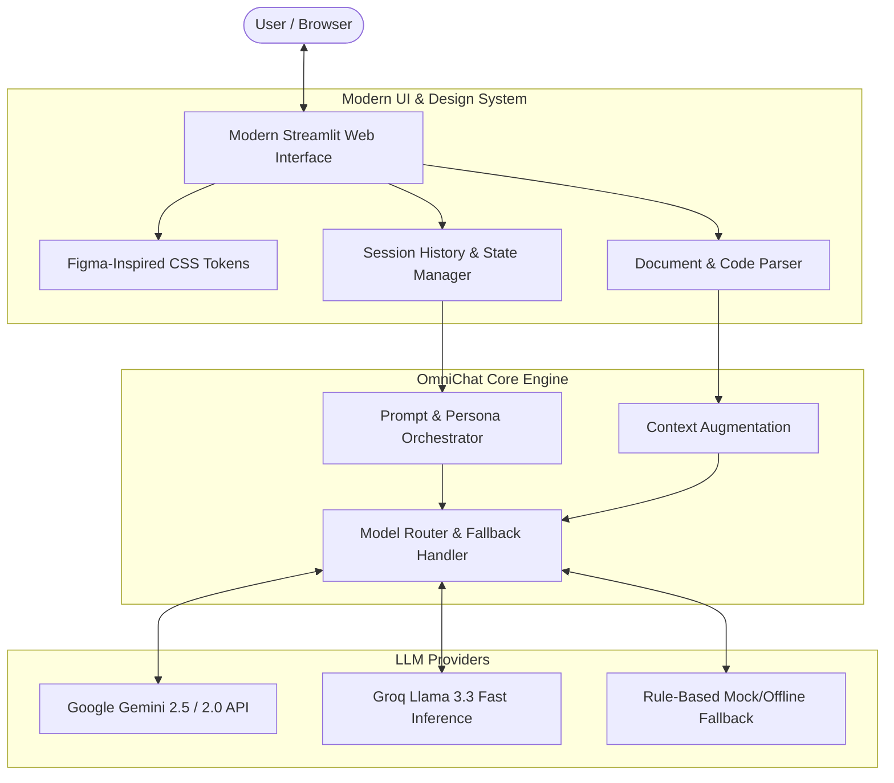

# OmniChat AI — Project Plan
**Hackathon:** [Build Your First AI App (Devpost)](https://build-your-first-ai-app.devpost.com/)  
**Track:** AI Chatbots & Intelligent Productivity Assistants  
**Repository:** [msekhardhar-cell/First-AI-App](file:///home/swarna-sekhar-dhar/projects/mamata/First-AI-App)  
**Author:** msekhardhar-cell (`msekhar.dhar@gmail.com`)  
**Target Deadline:** November 27, 2026  

---

## 1. Executive Summary & Problem Statement

### The Problem
Most beginner AI chatbot projects are bare wrappers around a single API endpoint:
- Generic, sluggish user interfaces with default styling and poor visual hierarchy.
- Lack of customizable personas, memory retention, or context management.
- Inability to interact with user-uploaded files, notes, or snippets.
- Zero consideration for design tokens, accessibility, and production deployment.

### The Solution: OmniChat AI
**OmniChat AI** is a modern, responsive, and multimodal AI chatbot built with Python and modern web technologies, styled using a high-end design token architecture inspired by modern Figma design systems (Linear, Vercel, and Apple Human Interface Guidelines). 

It bridges conversational AI with practical utility:
1. **Adaptive Personas:** Seamlessly switch between *General Assistant*, *Senior Code Architect*, *Academic Study Partner*, and *Executive Summarizer*.
2. **Context-Aware Multimodality:** Drag-and-drop code files, documents, or study notes for real-time Q&A and synthesis.
3. **Figma-Inspired Modern UI:** Dark/Light theme, glassmorphism accents, smooth streaming animations, syntax-highlighted code blocks with 1-click copy, and collapsible thought traces.
4. **Zero-Friction Deployment:** One-click deployment to Streamlit Community Cloud or Hugging Face Spaces, fulfilling all Devpost criteria.

---

## 2. Devpost Challenge Alignment & Judging Criteria

| Devpost Criteria | Weight | OmniChat AI Execution |
| :--- | :--- | :--- |
| **Creativity & Originality** | High | Dynamic persona cards, conversational branching, and prompt inspiration chips with interactive context attachment. |
| **Implementation & Functionality** | High | Robust streaming LLM responses, resilient error handling with API failover, token counting, and multi-file ingestion. |
| **Usefulness & Real-World Impact** | High | Solves daily productivity hurdles for students and developers (instant code debugging, study guides, structured notes). |
| **Presentation & Documentation** | High | Polished Figma-derived UI, architectural diagrams, video walkthrough script, and clear setup guide. |

---

## 3. System Architecture & Tech Stack

### Technology Selection
- **Frontend / Application Framework:** Python 3.10+ with **Streamlit** (custom CSS injection for modern Figma design tokens).
- **Core AI Models:** **Google Gemini 2.5 Flash** (high reasoning capability, fast response times, generous free tier) with optional **Groq / Llama 3.3** for instant inference.
- **Document & File Handling:** Native parsing for `.txt`, `.py`, `.js`, `.json`, `.csv`, `.md`, and `.pdf`.
- **Styling Architecture:** Custom CSS variables matching modern Figma design systems:
  - Deep obsidian dark background (`#0d1117`, `#161b22`)
  - Accent neon violet & electric blue gradients (`#8a2be2`, `#3b82f6`)
  - Subtle frosted glass borders and elevated cards
  - Clean Inter / SF Pro typography hierarchy

---

## 4. Key Functional Features

1. **Streaming Multi-Turn Conversations:** Natural, real-time typing effect with Markdown and LaTeX math rendering.
2. **Persona Switcher:**
   - 🤖 *Omni Assistant* (Balanced, helpful, concise)
   - 💻 *Code Architect* (Refactoring, architecture reviews, unit tests)
   - 🎓 *Study Tutor* (Socratic questioning, concept simplification, quiz generator)
   - ⚡ *Fast Summarizer* (Bullet points, key takeaways, action items)
3. **Smart Prompt Starter Chips:** One-click pre-engineered prompts to immediately showcase capabilities to hackathon judges.
4. **File & Code Ingestion:** Attach project files or notes directly into conversation context.
5. **Session Management & Export:**
   - Download chat history as Markdown or JSON.
   - Clear session with confirmation modal.
   - Estimated token & latency metrics.

---

## 5. Security & Submission Compliance
- **Zero API Key Leakage:** `.env.example` provided; `.env` strictly git-ignored.
- **Clean Git History:** Commits attributed directly to `msekhardhar-cell`.
- **Public Open-Source License:** MIT License already initialized.
- **Self-Contained Run:** Single command setup via `pip install -r requirements.txt && streamlit run app.py`.
