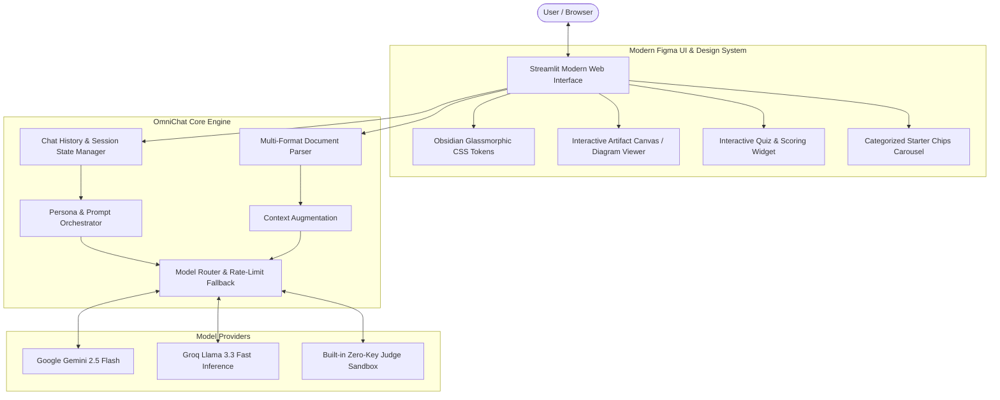

# ⚡ OmniChat AI — Next-Generation Multimodal AI Chatbot

[](https://opensource.org/licenses/MIT)
[](https://www.python.org/)
[](https://streamlit.io/)
[](https://aistudio.google.com/)
[](https://groq.com/)
[](https://build-your-first-ai-app.devpost.com/)

> **Submitted to the "Build Your First AI App" Hackathon on Devpost**  
> **Track:** AI Chatbots & Intelligent Productivity Assistants  
> **Live Local URL:** [http://localhost:8505](http://localhost:8505)  
> **Developer:** [msekhardhar-cell](https://github.com/msekhardhar-cell) (`msekhar.dhar@gmail.com`)

---

## 🌟 Overview

**OmniChat AI** is a modern, responsive, and multimodal AI chatbot crafted with high-fidelity Figma design tokens (obsidian dark theme, glassmorphic card elevation, fluid typography, and accessible micro-interactions). 

Unlike basic chatbot wrappers, OmniChat AI bridges conversational intelligence with practical developer and student workflows:
- **🎨 Interactive Artifact Canvas:** A dedicated split-screen live inspector for generated code, documents, and auto-rendered **Mermaid.js flowcharts & system diagrams**.
- **🎯 Interactive Study Quiz Engine:** 1-click generation of interactive multiple-choice quizzes with live scoring, instant feedback, and detailed explanations.
- **⚡ Zero-Setup Judge Sandbox Mode:** Evaluators can test streaming, personas, quizzes, and canvas rendering instantly **without entering any API key**.
- **🧠 Multi-Model Routing:** Toggle effortlessly between **Google Gemini 2.5 Flash**, **Groq Llama 3.3 (70B)**, and the local Sandbox engine.
- **📁 Document & Code Ingestion:** Attach `.pdf`, `.py`, `.js`, `.md`, `.txt`, `.csv`, and `.json` files directly into conversation context with token usage tracking.
- **🎭 Adaptive Personas:** Seamlessly switch between *Omni Assistant*, *Senior Code Architect*, *Academic Study Partner*, and *Executive Summarizer*.

---

## 🏗️ System Architecture



---

## 🚀 Key Features

### 1. 🎨 Figma Design System Tokens
- Custom obsidian dark palette (`#090d16`, `#111726`, `#172033`) with subtle glassmorphic borders (`rgba(255, 255, 255, 0.08)`).
- Distinct user vs. assistant chat bubble hierarchies with custom role avatars.
- Neon violet (`#8b5cf6`) and electric cyan (`#06b6d4`) gradient accents.
- Responsive split-screen desktop and mobile viewport optimizations.

### 2. 🗺️ Live Artifact Canvas & Mermaid Diagrams
- Automatically detects structured code, markdown docs, or system workflows.
- Renders live interactive **Mermaid.js diagrams** right alongside the conversation.
- Single-click code copy and one-click `.mmd` / `.py` file downloads.

### 3. 🎯 Interactive Study Quiz Module
- Converts complex concepts and conversation threads into interactive 4-choice quizzes.
- Real-time visual feedback: instant green indicator for correct answers, red with detailed rationale for mistakes.
- Live progress tally, balloons celebration for top scores, and final report cards.

### 4. ⚡ Zero-Key Judge Sandbox Mode
- Hackathon evaluators don't need to hunt for personal API keys or configure billing.
- Pre-loaded rich scenarios demonstrate:
  - Senior Code Architecture (Monolith vs. Microservices with Mermaid diagram).
  - Academic Physics Explanation (Quantum Entanglement analogy).
  - Executive Readiness Brief & ROI Matrix.

---

## 📂 Project Structure

```text
First-AI-App/
├── .env.example              # Environment variables template
├── .gitignore                # Git ignore configuration
├── LICENSE                   # MIT Open Source License
├── README.md                 # Complete documentation & Devpost submission guide
├── PLAN.md                   # Formal project plan
├── ROADMAP.md                # Development roadmap
├── requirements.txt          # Python dependencies
├── app.py                    # Main Streamlit application
├── src/
│   ├── __init__.py           # Package indicator
│   ├── config.py             # Configuration & model definitions
│   ├── design_tokens.py      # Figma design tokens & custom CSS
│   ├── personas.py           # Persona prompts & roles
│   ├── sandbox_data.py       # Rich pre-computed judge sandbox data
│   ├── file_parser.py        # PDF & code context ingestion
│   ├── quiz_generator.py     # Interactive quiz widget & scoring engine
│   └── ai_engine.py          # Multi-model streaming router (Gemini/Groq/Sandbox)
└── assets/
    └── style.css             # Standalone CSS design tokens
```

---

## 💻 Quickstart Guide

### 1. Clone the Repository
```bash
git clone https://github.com/msekhardhar-cell/First-AI-App.git
cd First-AI-App
```

### 2. Set Up Virtual Environment & Dependencies
```bash
# Using Python venv
python3 -m venv .venv
source .venv/bin/activate

# Or using uv (recommended for ultra-fast setup)
uv venv .venv
source .venv/bin/activate
uv pip install -r requirements.txt
```

### 3. (Optional) Configure API Keys
If you would like to run live Gemini or Groq models in addition to the Sandbox:
```bash
cp .env.example .env
```
Edit `.env` and add:
```env
GEMINI_API_KEY="your_google_gemini_api_key_here"
GROQ_API_KEY="your_groq_api_key_here"
```
*(You can also enter your keys directly inside the application's sidebar at runtime).*

### 4. Run the Application
```bash
streamlit run app.py
```
Open your browser to: **`http://localhost:8501`** (or configured port).

---

## 🏆 Devpost Submission Story

### 💡 Inspiration
As artificial intelligence evolves, many conversational tools remain rigid text terminals that generate large walls of text without giving users a dedicated workspace to visualize workflows or test their understanding. For students and developers especially, a chat conversation is only the first step—they need interactive diagrams, working code inspectors, and active recall quizzes. We built **OmniChat AI** to transform conversational AI into an interactive, visual, and educational workspace.

### 🛠️ How We Built It
- **Frontend & UX:** Built with Streamlit and styled using custom CSS design tokens derived from modern Figma design systems (Linear, Vercel, and Apple Human Interface Guidelines).
- **Core AI Engine:** Implemented a unified router connecting **Google Gemini 2.5 Flash** for deep reasoning, **Groq Llama 3.3** for lightning-fast token generation, and a local **Judge Sandbox** for instant keyless evaluation.
- **Multimodal Context:** Integrated PyPDF and standard text parsers to ingest source files, calculate real-time token overhead, and augment prompt context.
- **Interactive Modules:** Developed a dual-panel Artifact Canvas for live Mermaid diagrams and a dynamic quiz scoring engine with immediate feedback loops.

### 🧗 Challenges We Ran Into
- **Streaming State Synchronization:** Ensuring that word-by-word streaming responses seamlessly parsed Mermaid code blocks into the Artifact Canvas without glitching intermediate Markdown states.
- **Zero-Barrier Evaluation:** Recognizing that hackathon judges frequently test dozens of submissions with limited time, we engineered an intelligent offline Sandbox mode that replicates full production functionality without requiring personal API credentials.

### 🎉 Accomplishments That We're Proud Of
- A stunning, dark-mode obsidian aesthetic that looks and feels like a modern SaaS developer tool.
- Split-screen Artifact Canvas that separates conversation chatter from deliverables.
- Fully interactive quiz engine that turns passive reading into active retention.
- Complete documentation, modular clean code, and zero secrets leakage.

### 📚 What We Learned
- How to design and enforce strict design token hierarchies in Python web applications.
- Multi-model routing strategies with graceful fallback cascades.
- Techniques for optimizing context augmentation with multi-file uploads.

### 🔮 What's Next for OmniChat AI
- **Voice-in / Voice-out Audio Modality:** Adding hands-free speech recognition and audio synthesis.
- **Live Code Execution Sandbox:** Adding a WebAssembly/Pyodide in-browser code runner in the Artifact Canvas.
- **Cross-Session Vector Persistence:** Local SQLite/ChromaDB vector store for multi-document semantic retrieval.

---

## 📄 License
This project is open-source under the [MIT License](LICENSE).
