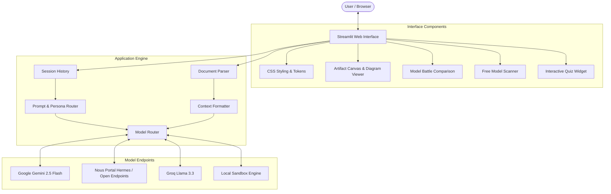

# OmniChat

A chat workspace with real-time model comparison, an artifact canvas for code and diagrams, dynamic free model scanning, and an interactive study quiz engine.

Built for the [Build Your First AI App Hackathon](https://build-your-first-ai-app.devpost.com/) on Devpost (Yasir Insights).  
Author: [msekhardhar-cell](https://github.com/msekhardhar-cell) (`msekhar.dhar@gmail.com`)  
Local Application: [http://localhost:8505](http://localhost:8505)  
Submission Details: [DEVPOST_SUBMISSION.md](DEVPOST_SUBMISSION.md)  
Video Walkthrough Guide: [DEMO_VIDEO_SCRIPT.md](DEMO_VIDEO_SCRIPT.md)  

---

## What OmniChat Does

Most chat tools dump long answers into a single text column. When a question involves software architecture, code snippets, or study material, that single-column format quickly gets cluttered.

OmniChat organizes the workspace into dedicated tools:
1. Split-Screen Artifact Canvas: When an answer includes code or a diagram, OmniChat parses it into a side panel. System diagrams render as interactive Mermaid.js flowcharts with one-click export.
2. Model Battle and Comparison: Submit a prompt to stream answers from two different models side-by-side. Track completion times and vote on the better output.
3. Free Model Scanner: Queries open inference endpoints (including Nous Portal) to identify zero-cost models in real time and makes them selectable in the comparison arena.
4. Interactive Study Quiz: Click a button to turn discussion topics into self-grading multiple choice quizzes with instant explanations.
5. Multi-format Document Ingestion: Attach text, markdown, python, javascript, or PDF files to ground the conversation in local context.
6. Persona Modes: Dedicated system instructions for general assistance, software architecture reviews, study tutoring, and executive summaries.
7. Evaluator Sandbox Mode: Pre-loaded responses so evaluators can test the entire workflow without signing up for API keys or paying for credits.

---

## Architecture



---

## Project Structure

```text
First-AI-App/
├── .env.example              # Template for API keys
├── .gitignore                # Git ignore rules
├── LICENSE                   # MIT License
├── README.md                 # Project documentation
├── DEVPOST_SUBMISSION.md     # Devpost entry form text
├── DEMO_VIDEO_SCRIPT.md      # Timed video walkthrough script
├── PLAN.md                   # Project plan
├── ROADMAP.md                # Development roadmap
├── requirements.txt          # Python dependencies
├── app.py                    # Main Streamlit application
├── src/
│   ├── __init__.py
│   ├── config.py             # Model settings and endpoints
│   ├── design_tokens.py      # CSS design tokens
│   ├── personas.py           # Persona prompts
│   ├── sandbox_data.py       # Pre-loaded evaluator sandbox responses
│   ├── file_parser.py        # PDF, code, and text document parser
│   ├── quiz_generator.py     # Interactive quiz widget
│   ├── model_scanner.py      # Live scanner for free models
│   └── ai_engine.py          # Multi-model streaming router
└── assets/
    └── style.css             # Standalone CSS
```

---

## Quickstart

### 1. Clone the repository
```bash
git clone https://github.com/msekhardhar-cell/First-AI-App.git
cd First-AI-App
```

### 2. Set up the virtual environment
```bash
# Using uv (fastest)
uv venv .venv
source .venv/bin/activate
uv pip install -r requirements.txt

# Or using standard python
python3 -m venv .venv
source .venv/bin/activate
pip install -r requirements.txt
```

### 3. (Optional) Add API Keys
The application starts in Sandbox Mode by default, which needs no API keys. If you want to query live models:
```bash
cp .env.example .env
```
Add your keys to `.env`:
```env
GEMINI_API_KEY="your_key_here"
NOUS_API_KEY="your_key_here"
GROQ_API_KEY="your_key_here"
```
You can also enter keys directly into the sidebar in the browser.

### 4. Run the app
```bash
streamlit run app.py
```
Open your browser to `http://localhost:8501` (or the port displayed in your terminal).

---

## License
MIT License. See [LICENSE](LICENSE) for details.
