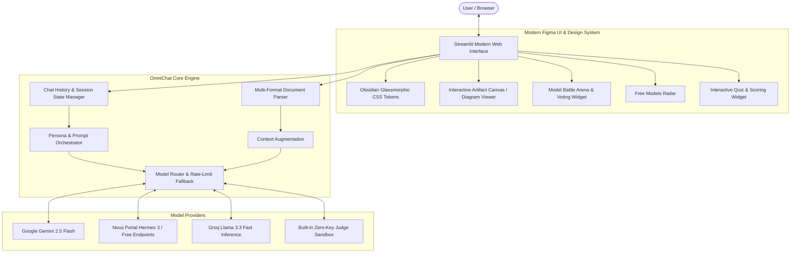

# ⚡ OmniChat AI — Next-Generation Multimodal AI Chatbot

[](https://opensource.org/licenses/MIT)
[](https://www.python.org/)
[](https://streamlit.io/)
[](https://aistudio.google.com/)
[](https://portal.nousresearch.com/)
[](https://groq.com/)
[](https://build-your-first-ai-app.devpost.com/)

> **Official Entry for the ["Build Your First AI App" Hackathon on Devpost](https://build-your-first-ai-app.devpost.com/)**  
> **Track:** AI Chatbots & Intelligent Productivity / Study Assistants  
> **Developer:** [msekhardhar-cell](https://github.com/msekhardhar-cell) (`msekhar.dhar@gmail.com`)  
> **Live Local Application URL:** [http://localhost:8505](http://localhost:8505)  
> **Devpost Submission Guide:** [DEVPOST_SUBMISSION.md](DEVPOST_SUBMISSION.md)  
> **Video Demo Script:** [DEMO_VIDEO_SCRIPT.md](DEMO_VIDEO_SCRIPT.md)  

---

## 🌟 Overview

**OmniChat AI** is a modern, responsive, and multimodal AI chatbot crafted with high-fidelity Figma design tokens (obsidian dark theme, glassmorphic card elevation, fluid typography, and accessible micro-interactions). 

Unlike basic chatbot wrappers, OmniChat AI bridges conversational intelligence with practical developer and student workflows:
- **🎨 Interactive Artifact Canvas:** A dedicated split-screen live inspector for generated code, documents, and auto-rendered **Mermaid.js flowcharts & system diagrams**.
- **⚔️ Multi-Model "Battle / Compare" Mode:** Pit two AI models side-by-side to stream responses simultaneously, compare latency and reasoning quality, and vote on the winner.
- **📡 Free Models Radar:** Automatically scans Nous Portal (`https://inference-api.nousresearch.com/v1/models`) and open endpoints to discover 19+ active zero-cost models in real time.
- **🎯 Interactive Study Quiz Engine:** 1-click generation of interactive multiple-choice quizzes with live scoring, instant feedback, and detailed explanations.
- **⚡ Zero-Setup Judge Sandbox Mode:** Evaluators can test streaming, personas, quizzes, and canvas rendering instantly **without entering any API key**.
- **🧠 Multi-Model Routing:** Toggle effortlessly between **Google Gemini 2.5 Flash**, **Nous Portal Hermes 3**, **Groq Llama 3.3 (70B)**, and the local Sandbox engine.
- **📁 Document & Code Ingestion:** Attach `.pdf`, `.py`, `.js`, `.md`, `.txt`, `.csv`, and `.json` files directly into conversation context with token usage tracking.
- **🎭 Adaptive Personas:** Seamlessly switch between *Omni Assistant*, *Senior Code Architect*, *Academic Study Partner*, and *Executive Summarizer*.

---

## 🏗️ System Architecture



---

## 🚀 Key Features

### 1. 🎨 Figma Design System Tokens
- Custom obsidian dark palette (`#090d16`, `#111726`, `#172033`) with subtle glassmorphic borders (`rgba(255, 255, 255, 0.08)`).
- Distinct user vs. assistant chat bubble hierarchies with custom role avatars.
- Neon violet (`#8b5cf6`) and electric cyan (`#06b6d4`) gradient accents.
- Responsive split-screen desktop and mobile viewport optimizations.

### 2. 🗺️ Live Artifact Canvas & Mermaid Diagrams
- Automatically detects structured code, markdown docs, or system workflows.
- Renders live interactive **Mermaid.js diagrams** right alongside the conversation.
- Single-click code copy and one-click `.mmd` / `.py` file downloads.

### 3. ⚔️ Model Battle Arena
- Pit any two models against each other on the exact same prompt (e.g., Gemini vs. Nous Hermes).
- Watch both models stream answers in parallel columns.
- Compare completion latency and token rendering speed.
- Interactive voting buttons with a live score tally.

### 4. 📡 Free Models Radar
- Dynamically queries Nous Portal's inference API and open endpoints.
- Auto-detects and lists all zero-cost models (such as `qwen/qwen4-max:free`, `tencent/hy4-flash:free`, `stepfun/step-3.7-flash:free`, `upstage/solar-mini4:free`, `meituan/longcat-2.5:free`, `google/gemma-4:free`, etc.) with context window sizes.
- Select any discovered free model directly into the Battle Arena!

### 5. 🎯 Interactive Study Quiz Module
- Converts complex concepts and conversation threads into interactive 4-choice quizzes.
- Real-time visual feedback: instant green indicator for correct answers, red with detailed rationale for mistakes.
- Live progress tally, balloons celebration for top scores, and final report cards.

### 6. ⚡ Zero-Key Judge Sandbox Mode
- Hackathon evaluators don't need to hunt for personal API keys or configure billing.
- Pre-loaded rich scenarios demonstrate:
  - Senior Code Architecture (Monolith vs. Microservices with Mermaid diagram).
  - Academic Physics Explanation (Quantum Entanglement analogy).
  - Executive Readiness Brief & ROI Matrix.

---

## 📂 Project Structure

```text
First-AI-App/
├── .env.example              # Environment variables template
├── .gitignore                # Git ignore configuration
├── LICENSE                   # MIT Open Source License
├── README.md                 # Complete documentation & Devpost submission guide
├── DEVPOST_SUBMISSION.md     # Exact copy-paste text for the Devpost entry form
├── DEMO_VIDEO_SCRIPT.md      # 2-minute timed demo video & presentation script
├── PLAN.md                   # Formal project plan
├── ROADMAP.md                # Development roadmap
├── requirements.txt          # Python dependencies
├── app.py                    # Main Streamlit application
├── src/
│   ├── __init__.py           # Package indicator
│   ├── config.py             # Configuration & model definitions
│   ├── design_tokens.py      # Figma design tokens & custom CSS
│   ├── personas.py           # Persona prompts & roles
│   ├── sandbox_data.py       # Rich pre-computed judge sandbox data
│   ├── file_parser.py        # PDF & code context ingestion
│   ├── quiz_generator.py     # Interactive quiz widget & scoring engine
│   ├── model_scanner.py      # Dynamic Free Models Scanner for Nous Portal
│   └── ai_engine.py          # Multi-model streaming router (Gemini/Nous/Groq/Sandbox)
└── assets/
    └── style.css             # Standalone CSS design tokens
```

---

## 💻 Quickstart Guide

### 1. Clone the Repository
```bash
git clone https://github.com/msekhardhar-cell/First-AI-App.git
cd First-AI-App
```

### 2. Set Up Virtual Environment & Dependencies
```bash
# Using uv (fastest)
uv venv .venv
source .venv/bin/activate
uv pip install -r requirements.txt

# Or using standard python venv
python3 -m venv .venv
source .venv/bin/activate
pip install -r requirements.txt
```

### 3. (Optional) Configure API Keys
The application functions immediately in **Judge Sandbox Mode** without any keys. If you wish to use live providers:
```bash
cp .env.example .env
```
Edit `.env` and add:
```env
GEMINI_API_KEY="your_google_gemini_api_key"
NOUS_API_KEY="your_nous_portal_api_key"
GROQ_API_KEY="your_groq_api_key"
```
*(Keys can also be provided directly via the UI sidebar at runtime).*

### 4. Run the Application
```bash
streamlit run app.py
```
Open your browser to: **`http://localhost:8501`** (or configured port).

---

## 🏆 Devpost Submission Story
See the complete field-by-field copy-paste submission text in [DEVPOST_SUBMISSION.md](DEVPOST_SUBMISSION.md).

---

## 📄 License
This project is open-source under the [MIT License](LICENSE).
