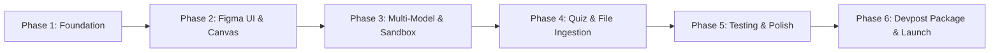

# OmniChat AI — Development Roadmap (Enhanced)
**Project:** [First-AI-App](file:///home/swarna-sekhar-dhar/projects/mamata/First-AI-App)  
**Target Completion:** Prior to November 27, 2026  
**Status:** In Progress 🚀  

---



---

## Phase 1: Environment Setup & Project Scaffolding
- [x] Configure repository git identity (`msekhardhar-cell`, `msekhar.dhar@gmail.com`).
- [x] Configure dedicated SSH authentication (`~/.ssh/id_ed25519_msekhardhar`).
- [x] Write baseline project plan and roadmap.
- [ ] Initialize Python environment, `.gitignore`, `.env.example`, and `requirements.txt`.
- [ ] Scaffold modular directory layout:
  ```text
  First-AI-App/
  ├── .gitignore
  ├── .env.example
  ├── README.md
  ├── PLAN.md
  ├── ROADMAP.md
  ├── requirements.txt
  ├── app.py
  ├── src/
  │   ├── __init__.py
  │   ├── config.py
  │   ├── design_tokens.py
  │   ├── ai_engine.py
  │   ├── personas.py
  │   ├── file_parser.py
  │   ├── quiz_generator.py
  │   └── sandbox_data.py
  └── assets/
      └── style.css
  ```

---

## Phase 2: Figma-Inspired Design System & Artifact Canvas
- [ ] Implement `assets/style.css` and `src/design_tokens.py`:
  - Obsidian dark theme, glassmorphic elevation, and neon glow accents.
  - Distinct user and assistant message bubble typography.
- [ ] Build the Main Layout in `app.py`:
  - Header with model selector, status pill, and judge sandbox badge.
  - Collapsible Sidebar for settings, persona configuration, and context files.
  - Categorized prompt starter carousel chips (`💻 Code`, `🎓 Study`, `📊 Quiz`, `⚡ Summarize`).
- [ ] Implement **Interactive Artifact Canvas**:
  - Split-screen drawer for code preview, raw markdown, and live Mermaid.js flowcharts.

---

## Phase 3: Multi-Model Router & Zero-Key Judge Sandbox
- [ ] Build `src/ai_engine.py`:
  - Google Gemini integration (`gemini-2.5-flash` via `google-genai` SDK).
  - Optional Groq Llama 3.3 integration.
  - Streaming response generator with real-time token rendering.
- [ ] Build `src/sandbox_data.py`:
  - High-quality pre-packaged simulated scenarios for judges testing without API keys (debugging Python code, explaining quantum mechanics, generating system architecture diagrams).
- [ ] Build `src/personas.py`:
  - Personas: *Omni Assistant*, *Code Architect*, *Study Tutor*, *Executive Summarizer*.

---

## Phase 4: Interactive Quiz Engine & File Context
- [ ] Build `src/quiz_generator.py`:
  - Automated structured quiz generator from chat history or uploaded documents.
  - Interactive clickable options with real-time green/red feedback and score counter.
- [ ] Build `src/file_parser.py`:
  - Text & PDF extraction (`.pdf`, `.py`, `.md`, `.txt`, `.csv`).
  - Active attachment chips and context window estimation.

---

## Phase 5: Verification, Local Smoke Testing & Polish
- [ ] End-to-end smoke test across all 3 providers (Gemini, Groq, Offline Sandbox).
- [ ] Verify quiz interaction flow and score calculation.
- [ ] Verify Mermaid diagram rendering in the Artifact Canvas.
- [ ] Test chat history export (Markdown & JSON).

---

## Phase 6: Devpost Submission Package & Launch
- [ ] High-resolution architecture diagrams and UI screenshots.
- [ ] Comprehensive [README.md](file:///home/swarna-sekhar-dhar/projects/mamata/First-AI-App/README.md) with quickstart instructions and video demo script.
- [ ] Devpost submission story documentation.
- [ ] Commit and push all clean code to `msekhardhar-cell/First-AI-App`.
