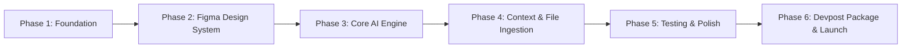

# OmniChat AI — Development Roadmap
**Project:** [First-AI-App](file:///home/swarna-sekhar-dhar/projects/mamata/First-AI-App)  
**Target Completion:** Prior to November 27, 2026  
**Status:** In Progress 🚀  

---



---

## Phase 1: Environment Setup & Project Scaffolding
- [x] Configure repository git identity (`msekhardhar-cell`, `msekhar.dhar@gmail.com`).
- [x] Configure dedicated SSH authentication (`~/.ssh/id_ed25519_msekhardhar`).
- [ ] Create standardized project structure:
  ```text
  First-AI-App/
  ├── .gitignore
  ├── .env.example
  ├── README.md
  ├── PLAN.md
  ├── ROADMAP.md
  ├── requirements.txt
  ├── app.py
  ├── src/
  │   ├── __init__.py
  │   ├── config.py
  │   ├── design_tokens.py
  │   ├── ai_engine.py
  │   ├── personas.py
  │   └── file_parser.py
  └── assets/
      └── style.css
  ```
- [ ] Define Python dependencies (`streamlit`, `google-genai`, `python-dotenv`, `pypdf`, `pillow`).

---

## Phase 2: Figma-Inspired Design System & UI Tokens
- [ ] Define the Design Token Specification:
  - Color palette: Obsidian dark background, elevated card surfaces, vibrant violet/blue primary accents, high-contrast typography.
  - Spacing & Radius: 8pt grid, 12px/16px rounded borders, smooth box-shadow elevations.
  - Glassmorphic card styling and modern button hover micro-interactions.
- [ ] Implement `assets/style.css` and `src/design_tokens.py`:
  - Custom scrollbars, sleek chat bubbles (distinct user vs assistant styling), and animated badges.
  - Responsive layout optimized for desktop and mobile viewports.
- [ ] Build the UI Layout in `app.py`:
  - Modern Header with status badge ("Online", model indicator).
  - Collapsible Sidebar for settings, persona selection, and file attachments.
  - Prompt starter chips at the start of empty sessions.

---

## Phase 3: Core AI Engine & Multi-Model Integration
- [ ] Build `src/ai_engine.py`:
  - Support Google Gemini (`gemini-2.5-flash` / `gemini-1.5-pro` via new `google-genai` SDK).
  - Fallback / optional provider (Groq / simulated mode for zero-key evaluation).
  - Implement streaming generator (`stream=True`) for word-by-word typing effect.
- [ ] Build `src/personas.py`:
  - Define system prompts for each role (Omni Assistant, Code Mentor, Study Tutor, Executive Summarizer).
  - Add persona icons and contextual description banners.
- [ ] Conversational Memory:
  - Maintain message history across turns using Streamlit session state.
  - Provide chat wipe / reset action.

---

## Phase 4: Context Augmentation & File Ingestion
- [ ] Build `src/file_parser.py`:
  - Support uploading `.pdf`, `.txt`, `.py`, `.md`, and `.csv`.
  - Extract text and format into structured prompt context.
- [ ] Dynamic Context Badging:
  - Display active attached files as removable chip badges in the chat interface.
  - Inject document summaries or relevant excerpts into conversational turns.

---

## Phase 5: Verification, Local Smoke Testing & Polish
- [ ] End-to-end smoke test of streaming chat flow.
- [ ] Verify error states (missing API key, rate limits, network timeouts).
- [ ] Verify syntax highlighting on multiple programming languages (Python, JavaScript, C++, SQL).
- [ ] Test export options (Download conversation as Markdown / JSON).

---

## Phase 6: Devpost Submission Package & Launch
- [ ] Update [README.md](file:///home/swarna-sekhar-dhar/projects/mamata/First-AI-App/README.md) with:
  - High-resolution architecture diagram.
  - Feature highlights, screenshots, and live demo instructions.
  - Quickstart guide and configuration steps.
- [ ] Prepare Devpost submission text:
  - "Inspiration", "What it does", "How we built it", "Challenges we ran into", "Accomplishments that we're proud of", "What we learned", "What's next for OmniChat AI".
- [ ] Push all clean commits to `msekhardhar-cell/First-AI-App` on GitHub.
